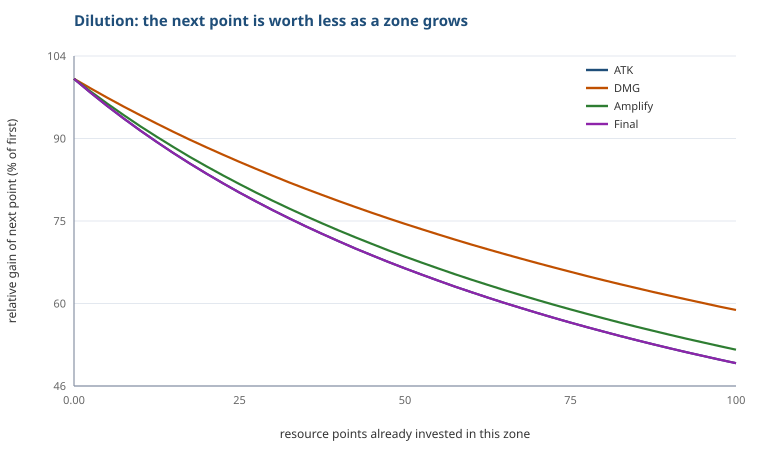
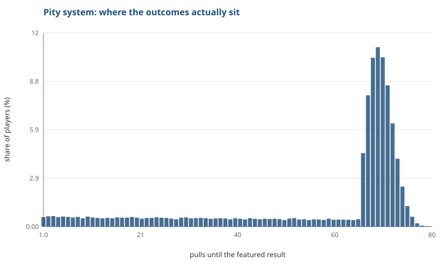
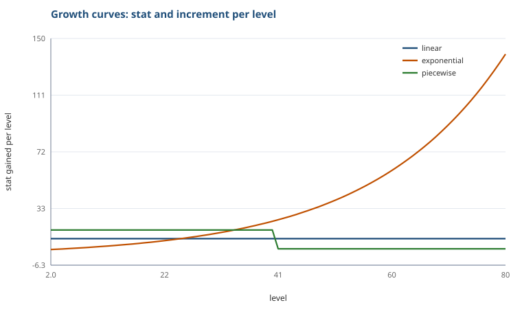

# game-numerics-toolkit

我在算《鸣潮》。

具体是算角色在 25 秒轴里打出多少伤害：哪个动作占多少、换一套配装差多少、下一份资源投到哪个乘区最划算。

一开始是为了自己配装。后来发现想算准，得先把伤害公式拆清楚，拆着拆着就整理成了这个仓库。现在它包含两部分：一套通用的数值分析工具，和一份完整的《鸣潮》九区公式解码。

零第三方依赖，Python 3.10+，clone 下来直接跑：

```bash
git clone https://github.com/Loveletter2/game-numerics-toolkit.git
cd game-numerics-toolkit
python cli.py demo --out docs/img
```

---

---

## 先看这三样

| 给谁看 | 看什么 |
|---|---|
| 只有 60 秒 | [**案例页**](https://loveletter2.github.io/game-numerics-toolkit/docs/demo/)：一张真实配装表，17 个动作的伤害占比 |
| 想知道怎么算的 | [**九区手册**](docs/wuwa-zones.md)：公式拆解，含六处和直觉相反的修正 |
| 想看靠不靠谱 | [**我这张表错在哪**](docs/validation-log.md)：三次发现自己算错，包括一次改错又改回来 |

## 拆解系列

数据表一列一列地拆，每篇配一个能重跑的脚本和一张图。

全部图表用一条命令重生成：

`ash
python deconstructions/charts.py <动作数据表.xlsx> <nanoka目录>
`

**先看这篇：[这个游戏是怎么调数值的](deconstructions/00-overview.md)** —— 十篇拆完之后的横向总结。
一句话概括：凡是玩家会横向比较的地方全部标准化，凡是体现角色个性的地方全部放开。

| # | 拆的是什么 | 一句话结论 |
|---|---|---|
| 01 | [闪避的无敌窗口](deconstructions/01-frames.md) | 只有两档：21 帧和 78 帧，后者是前者的 3.7 倍 |
| 02 | [协奏能量从哪来](deconstructions/02-energy.md) | 底噪 + 脉冲：58% 的动作给不到 2 点，少数条件动作给 30 以上 |
| 03 | [削韧值怎么分层](deconstructions/03-poise.md) | 大招中位 100、技能 40、普攻 26.7；400 是事实上的天花板 |
| 04 | [后摇其实是个常数](deconstructions/04-recovery.md) | 17～24 帧；手感差异来自动作长度，不是收招速度 |
| 05 | [武器白值差 176 点，实际差多少](deconstructions/05-weapons.md) | 白值差会被百分比放大；五星副属性主暴击，四星主攻击 |
| 06 | [敌人血量不是一条曲线](deconstructions/06-enemies.md) | 血量是「等级 × 难度档」的查表值；抗性最低 10%，没有 0 抗 |
| 07 | [所有角色的成长曲线是同一条](deconstructions/07-stats.md) | 1→90 都是 12.50 倍，六个突破倍率 60 个角色完全一致 |
| 08 | [2 件套填属性，5 件套定玩法](deconstructions/08-sonata.md) | 2 件套全是静态加成，5 件套 22/31 要写触发条件，且都挂在元素效应上 |
| 09 | [六成攻击是盒子](deconstructions/09-hitbox.md) | 矩形 63%；变奏/延奏是唯一圆形占多数的类；判定最大的反而不是攻击 |
| 10 | [共鸣技能只占 11%](deconstructions/10-multipliers.md) | 倍率的八成在回路/普攻/解放；E 是低倍率高功能的技能 |
| 11 | [更新日志里，纯数值改动只占 8%](deconstructions/11-changelog.md) | 一半以上改的是动作和判定 |
| 12 | [大招能量就是协奏能量的一半](deconstructions/12-ult-energy.md) | 比值固定 0.5；一个大招 = 2.5 条协奏的动作量 |
| 13 | [大招越贵，充得越慢](deconstructions/13-energy-budget.md) | 高消耗角色没有充能补贴，固定回复占比从 45% 掉到 17% |
| 14 | [破一个韧性条要几下](deconstructions/14-toughness.md) | 韧性只有十个档位且不随等级变；800 韧性两个大招破 |
| — | [**总览：怎么调数值**](deconstructions/00-overview.md) | 标准化与差异化的分工 |

## 它回答四个问题

下面几个问题社区里争了很多年，大多是「应该是这样吧」。这里给的是能自己跑一遍验证的答案。

### 一、为什么「均衡堆属性」是对的？

伤害公式是**连乘**的：

```
伤害 = 攻击 × 倍率 × 暴击 × 增伤 × 加深 × 抗性 × 防御 × 终伤 × 易伤
```

连乘意味着，往任意一个乘区里加 `δ`，相对提升恒为：

```
相对提升 = δ / 该乘区当前值
```

**边际收益与这个乘区当前的大小成反比。** 这就是「稀释」的完整数学表述——不是玄学，是一条除法。



同一份投入，投在 1.1 的乘区上比投在 2.5 的乘区上多赚一倍多。

更进一步，如果总预算固定，最优解可以由拉格朗日条件解出来：

```
max  Σ ln(Zᵢ + eᵢ·pᵢ)   s.t.  Σ pᵢ = B
→     Zᵢ + eᵢ·pᵢ = eᵢ / λ
```

**最优时，各乘区的最终数值与它的「每点效率」成正比。** 当所有乘区效率相同时，最优解就是把所有乘区拉到同一数值——这才是「均衡」两个字的准确含义。

实测（`python cli.py allocate`）：

```
optimal (closed form)   damage = 3,159.2   gain = +10.34%
greedy (discrete)       damage = 3,159.2   gain = +10.34%
all-in on one zone      damage = 3,149.6   gain = +10.00%
```

闭式解与逐点贪心解在 0.005% 内一致，互相验证。

### 二、抽卡的期望抽数为什么不是 `1 / 概率`？

宣传 0.6% 的出货率，玩家算出来是 `1 / 0.006 ≈ 166.7` 抽。实际期望是 **57.2 抽**。

软保底从第 66 抽开始把概率托起来，硬保底在第 80 抽终结，尾部被截断，期望值因此塌掉了 **65.7%**。

```
naive 1/rate                =  166.67 pulls
analytic E[N]               =   57.15 pulls
simulated E[N] (n=200,000)  =   57.17 pulls
std dev = 21.12   p50 = 68   p90 = 72   p99 = 75
```

解析解用的是尾和公式 `E[N] = Σ P(N > k)`，和 20 万次蒙特卡洛的结果吻合到 0.04%——**这就是「算一遍」和「感觉一下」的区别**。



### 三、成长曲线的「手感」由什么决定？

不是由终值决定，而是由**每级增量**决定。



| 曲线 | 80 级终值 | 首级增量 | 末级增量 | 末/首 |
|---|---|---|---|---|
| 线性 | 1048.0 | 12.00 | 12.00 | 1.00 |
| 指数（×1.045/级） | 3237.3 | 4.50 | 139.41 | 30.98 |
| 分段（前 39 级 +18，后 +5） | 1002.0 | 18.00 | 5.00 | 0.28 |
| 对数 | 888.8 | 124.77 | 2.26 | 0.02 |

- **比值 = 1**：每级涨一样多，玩家没有变强的感觉。
- **比值 ≫ 1**：后期数值膨胀，早期关卡全部作废。
- **比值 < 1**：前期涨得猛、后期趋缓，**用终值不变换来新手期的成长感**——这就是分段曲线被大量采用的原因。

---

## 四、在我能凑出来的方案里，哪个最好？

单点计算回答「这套配装多少伤害」。真正要做的决策是「在我能凑出来的所有方案里，哪个最好，差多少」。

`python cli.py table` 枚举组合、排名、算出相对最优，并给每一行标注**最该补的乘区**：

```bash
python cli.py table --config examples/wuwa_demo.json --out out --top 10
```

```
rank  build                                            damage    % best
1     ATK=1320, Amplify=1.2, Crit=1.95, DMG=1.72      4,917.8   100.00%
2     ATK=1320, Amplify=1.1, Crit=1.95, DMG=1.72      4,508.0    91.67%
3     ATK=1200, Amplify=1.2, Crit=1.95, DMG=1.72      4,470.8    90.91%
4     ATK=1320, Amplify=1.2, Crit=1.95, DMG=1.46      4,174.4    84.88%
5     ATK=1200, Amplify=1.1, Crit=1.95, DMG=1.72      4,098.2    83.33%
```

同时导出三种格式：`builds.csv`（带 BOM，Excel 直接打开不乱码）、`builds.md`、`builds.xlsx`（可选，需要 openpyxl）。

**最后这一步才是重点**——工具会自己把表读回成结论：

```
108 builds evaluated; best and worst differ by 230.9%.
Best build: ATK=1320, Amplify=1.2, Crit=1.95, DMG=1.72 (4,917.8), 9.09% ahead of the runner-up.
In 67% of builds the best next investment is the same zone: ATK.
The best build is +71.76% over the baseline configuration.
```

一张表只是数据；**「在 67% 的方案里，最值得补的都是攻击区」**才是可以写进报告的那句话。

只改一个 JSON 就能换游戏：

```json
{
  "zones": [ ... ],
  "grid": {
    "ATK": [1080, 1200, 1320],
    "Crit": [1.18, 1.42, 1.605, 1.95],
    "DMG": [1.26, 1.46, 1.72],
    "Amplify": [1.0, 1.1, 1.2]
  }
}
```

`grid` 里每个乘区给一组候选值，剩下的组合由工具枚举（默认上限 20000 个，防止手滑写出天文数字）。

如果候选是**几个具体的组合**（比如几套声骸方案）而不是全网格，直接写 `builds`：

```json
{
  "builds": [
    { "name": "A · 全攻 2+2",        "overrides": { "ATK": 1440, "DMG": 1.30 } },
    { "name": "B · 攻击+增伤混搭",    "overrides": { "ATK": 1320, "DMG": 1.58 } },
    { "name": "C · 纯增伤套",        "overrides": { "ATK": 1200, "DMG": 1.86 } }
  ]
}
```

```bash
python cli.py table --config examples/echo_sets.json --out out
```

`overrides` 只覆盖你写的乘区，没写的沿用基础配置——所以一行就够表达一套配装。

---

## 用法

```
python cli.py damage   [--config examples/wuwa_demo.json] [--budget 1.0]
python cli.py allocate [--budget 10] [--step 0.01]
python cli.py table    [--out out] [--top 15] [--no-xlsx]
python cli.py gacha    [--base-rate 0.006] [--soft-pity 66] [--hard-pity 80]
python cli.py curves   [--levels 80]
python cli.py demo     [--out docs/img]
```

也可以当库用：

```python
from numerics import DamageModel, Zone, allocation_report

model = DamageModel("my build", [
    Zone("ATK", 1200, per_point_gain=12.0),   # 一点 = +1% 攻击
    Zone("Crit", 1.605, per_point_gain=0.008),
    Zone("DMG", 1.46, per_point_gain=0.01),
    Zone("Defense", 0.5714),                  # 敌人侧，不可投资
])

model.total()                 # 一次攻击的期望伤害
model.marginal_table()        # 各乘区每点收益排序
model.cheapest_zone()         # 最该补的那个区
allocation_report(model, 10)  # 最优分配 vs 贪心 vs 全砸一个
```

---

## 模块

| 模块 | 做什么 | 对应的策划日常 |
|---|---|---|
| `numerics.curves` | 线性 / 指数 / 分段 / 对数成长曲线，幂律拟合，增量诊断 | 定等级、技能、养成的成长曲线 |
| `numerics.damage` | 多乘区伤害模型，边际收益，稀释曲线，对数归因 | 反推公式、比较配装、找强度锚点 |
| `numerics.allocate` | 闭式解 + 贪心解 + 全砸一个的对比 | 预算有限时把词条投到哪里 |
| `numerics.builds` | 方案枚举、排名、相对基准、逐行诊断、CSV/MD/XLSX 导出 | 拉配装表、给结论 |
| `numerics.gacha` | 软保底 / 硬保底下的期望、分位、方差（解析 + 蒙特卡洛） | 卡池定价、保底设计、付费体验 |
| `numerics.wuwa` | 《鸣潮》九区公式：攻击三段、暴击基础值、三段抗性、等级防御常数 | 把解码结果固化成可测代码 |
| `numerics.charts` | 零依赖 SVG 折线图 / 柱状图 | 出报告、贴图 |

---

## 案例页

[\docs/demo/index.html\](docs/demo/index.html) —— 一张真实配装表的可视化：

- 25 秒输出轴的逐动作伤害归因
- 三个角色的伤害占比
- 每个动作取的是「期望」还是「必暴击」列
- 与表内自带总伤公式的交叉验证（差 0.000%）

单文件、零依赖、内联 SVG，浏览器直接打开即可，也可以挂 GitHub Pages。

重新生成：

\\ash
python case_study/build_demo.py <配装表.xlsx> docs/demo/index.html
\
---

## 一份真实游戏的完整解码：《鸣潮》九个乘区

通用工具证明"我会建模"。把一款在运营的游戏的伤害公式完整拆开、写成代码、并交叉验证——证明的是"我能把模型落到真实系统上"。

完整文档见 **[docs/wuwa-zones.md](docs/wuwa-zones.md)**，这里只放结论。

| # | 乘区 | 表达式 | 区内规则 | 可投资 |
|---|---|---|---|---|
| 1 | 攻击 / 生命 | `白值 × (1 + 百分比) + 数值` | 百分比求和 | ✅ 词条 |
| 2 | 倍率 | 技能等级表 | 固定 | ❌ |
| 3 | 暴击 | `1 + 暴击率 × (暴伤 − 1)` | 同池加算 | ✅ 词条 |
| 4 | 伤害加成 | `1 + Σ加成` | **加算** | ✅ 词条 |
| 5 | 伤害加深 | `Π(1 + Σ槽内)` | **槽内加算、槽间乘算** | ✅ 词条 |
| 6 | 抗性 | 三段函数 | 分段 | ❌ 敌人侧 |
| 7 | 防御 | `1/(1 + DEF_eff/K)` | `K=800+8×等级`，上限 2 | ❌ 敌人侧 |
| 8 | 终伤 | `Π(1 + 各项)` | 连乘 | ❌ 机制开关 |
| 9 | 易伤 | `1 + Σ` | 加算 | ❌ 共鸣链 |

### 六处「原本以为是 X，实际是 Y」

这些假设全部被数据推翻过，也是这套模型真正的价值：

| # | 原以为 | 实际 | 影响 |
|---|---|---|---|
| 1 | 防御常数 K = 800 | `K = 800 + 8×等级` | 90 级时差 15 个百分点 |
| 2 | 抗性线性 `1 − res` | 三段函数，负抗减半、高抗用倒数 | 减抗收益被高估 |
| 3 | 九个区区内都加算 | 加深、终伤**内部连乘** | 稀释只发生在加算区 |
| 4 | 暴击 `1 + CR×CD`（加成） | 基础 150% 是**总值** | 暴击流少算约 1/3 |
| 5 | 乘区无上限 | 防御封顶 2 倍、减伤封顶 100% | 极端配装会偏 |
| 6 | 取整可忽略 | 全程 `CEILING(...,1)` | 多段技能累积 +1 |

### 跨源校验

用**官方数据源**（角色面板、技能倍率 20 级表）与**社区汇总表**逐条比对：

| 技能 | 社区表（整数） | 官方数据 | 判定 |
|---|---|---|---|
| 普攻第一段 | 2450 | 24.50% | ✅ |
| 普攻第三段 | 1085 | 10.85% × 4 段 | ✅ |
| 共鸣技能 | 18100 | 181.00% | ✅ |
| 共鸣解放 | 40716 | 407.16% | ✅ |

**两个独立来源逐位一致**，同时确认了「万分之一精度整数」和「×N 段」两套记号的对应关系——
说明公式解码的输入层是可靠的，后面所有乘区运算建立在正确的倍率之上。

---

## 方法、边界与已知局限

这一节比上面所有代码都重要。

**模型算的是什么**：给定一套循环下的**理论期望输出**。

**模型不算的是什么**：操作收益、容错、机制联动。这三样在动作游戏里足以让纸面结论完全失效——一个纸面数值偏低的角色，只要存在「可提前打断且不丢失伤害」的连段路径，配合充能效率与队友流程耦合，实战强度就会显著高于模型预测。

**所以这个工具的定位是**：快速给出理论基线，然后由人来判断哪些地方需要偏离基线。**它的价值在于把「感觉」逼到只剩最后一个变量**，而不是替代判断。

具体案例见 [docs/case-notes.md](docs/case-notes.md)。

**其他局限**：

- 示例参数（`examples/wuwa_demo.json`）是**示意值，不是任何游戏的真实数据**；
- 乘区结构随版本演进（新区上线时需要同步扩展模型）；
- 保底模型假设单池、无跨池继承、无大小保底，实际卡池往往更复杂。

---

## 测试

```bash
python -m unittest discover -s tests -t .
```

44 个用例，覆盖公式正确性、边界条件、以及**两条独立路径互相验证**：

- 闭式解 vs 逐点贪心解（伤害差 < 0.5%）
- 解析期望 vs 蒙特卡洛（差 < 3%）
- 线性曲线的增量恒定、边际曲线严格递减
- 表格枚举的规模上限、CSV 的 BOM、Markdown 表格的转义

---

## 目录

```
numerics/      六个模块，纯标准库
cli.py         命令行入口
examples/      示例配置（示意参数）
tests/         单元测试
docs/img/      生成好的图表
docs/          方法论、九区手册、案例笔记
```

## License

MIT

