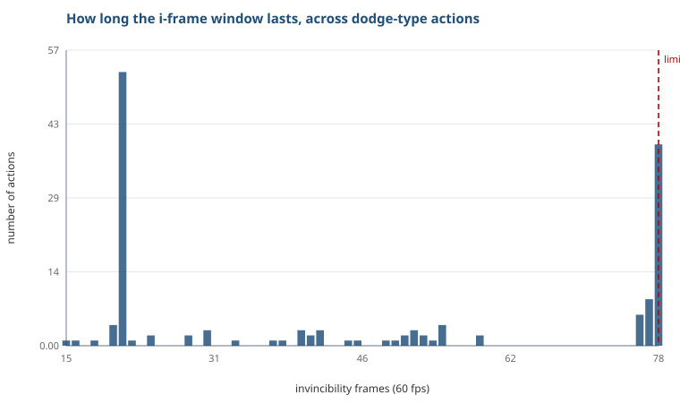

# 闪避到底能躲多久

动作数据表里有 5425 个动作，其中 582 个带无敌帧。我把所有名字里带「闪避」的都挑出来，只看一件事：无敌窗口有多长。

表是按 60 帧/秒记的，所以帧数除以 60 就是秒。

## 结果很短：只有两档

- **21 帧**，0.35 秒，53 条
- **78 帧**，1.30 秒，39 条

中间几乎没有东西。剩下的都是些零散的动作，各自 1 到 4 条。

这两档对应的就是普通闪避和极限闪避。

**极限闪避的无敌时间是普通闪避的 3.7 倍。**

## 顺带一个：闪避反击也在这个量级

闪避反击有 77 帧和 76 帧两种，样本分别是 9 条和 6 条，换算过来 1.28 秒和 1.27 秒。

也就是说打完反击那一下，人还是无敌的，时间几乎和极限闪避一样长。

## 少数形态的无敌反而更短

大多数角色共用同一套极限闪避（78 帧，39 条里包含绝大多数的「极限闪避-前/后」）。但有几种专属形态不一样：

| 动作 | 帧数 | 秒 |
|---|---|---|
| 观测极限闪避 | 59 | 0.98 |
| 凌霄极限闪避 | 55 | 0.92 |
| 盛绽·极限闪避 | 55 | 0.92 |
| 漫溯巡游·极限闪避 | 55 | 0.92 |
| 轮滑极限闪避 | 54 | 0.90 |

**全都比通用的短**，短 24% 到 31%。

这点和直觉相反。直觉上专属形态应该更强，但至少从无敌窗口看，它们是更短的。

## 我的理解

普通闪避 0.35 秒，够用但很紧，它是一个节奏工具，玩家靠它维持输出不断档。

极限闪避给到 1.30 秒，接近四倍。这个长度远超「躲开一下攻击」所需要的量，所以它更像是**奖励窗口**：你在对的时机闪，接下来一段时间里可以放心站桩打输出。

至于那几种专属形态为什么更短，我猜是拿无敌换了别的东西，比如位移距离、形态切换、或者闪避本身附带伤害。光看这一列看不出来，得把同几个动作的其他字段一起看才知道。

## 局限

- 这是数据表里的规格值。实际手感还受后摇、输入缓存、动作优先级影响，这些在这张表里是另外几列，我没一起算。
- 我只统计了名字里带「闪避」的动作。有些技能自带无敌帧（比如大招前置），没算进来，所以这里说的"最长无敌"只限于闪避这一类。
- 表里的动作名有简写和别名，同一个动作在不同角色下叫法不完全一样，我做的是名字精确匹配，可能会漏掉几条。

数据表一共 5425 行，这次只用了其中一列。削韧值、充能回收、动作结束帧都还没动。
