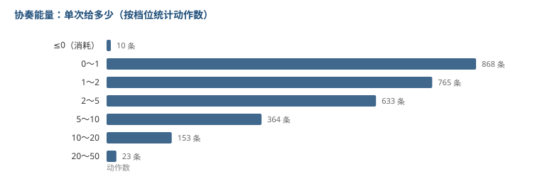

# 协奏能量是从哪来的

上一篇看的是闪避能躲多久。这篇换个字段，看协奏能量。

协奏能量攒满 100 就能换人，所以它的来源结构决定了「多久能换一次人」。这套节奏是动作游戏里最容易被玩家感知、也最难调的东西之一。

数据表 5425 个动作，有 2816 个给了协奏能量。

## 先说一个意外：有 10 个动作是倒扣的

大部分字段都是 0 或正数，但协奏回收这一列有负数：

| 动作 | 值 |
|---|---|
| 地面 E-椿花魔女 | -70 |
| 空中 E-椿花魔女 | -70 |
| E3-一日花 | -70 |
| E3-C2 一日花 | -70 |
| 强化 E-长按超负荷 | -60 |
| E3-C3 荷蓑出林 | -60 |

这些都是消耗协奏的设计，不是获得。

我一开始没想到会看到负数，因为直觉上「能量」是只进不出的资源。后来把这几条放回去看角色技能就明白了：有些形态切换本身要吃掉协奏，是拿资源换形态。

**这一列同时承载了「获得」和「消耗」两种语义**，如果只看正数会漏掉这类设计。

## 分布是两极的

| 单次给多少 | 动作数 |
|---|---|
| ≤0（消耗） | 10 |
| 0～1 | 868 |
| 1～2 | 765 |
| 2～5 | 633 |
| 5～10 | 364 |
| 10～20 | 153 |
| 20～50 | 23 |

**一半以上（1633 个，58%）的单次充能不到 2 点。** 这些基本是普攻逐段的小额，玩家感觉不到自己在攒能量。

另一边，单次给 20 以上的只有 23 条，占 0.8%。

## 常见的整额

| 值 | 动作数 |
|---|---|
| 10 | 178 |
| 1 | 98 |
| 20 | 91 |
| 2 | 52 |
| 5 | 44 |

10 点是最常见的单次值。

按 100 的上限算，**攒满一次协奏大约等于 10 次「10 点」的动作，或者 5 次「20 点」的动作**。

但真实情况不会这么整齐，因为大量 0.3、0.5、0.7 的小额动作也在往里填。这些碎片的累加效果，就是玩家打一套普攻时看到能量条在缓慢爬。

## 单次给得最多的

| 动作 | 值 |
|---|---|
| 缭乱-1 | 50 |
| 电锯 A4 | 45 |
| 强化重击-前置 | 40 |
| 显明告解-前置 | 40 |
| E-C6 反击 | 33 |
| 大招-前置 | 32 |
| 满能空中普攻-1 | 31 |

注意这些名字大多带「前置」「反击」「满能」，都是**条件触发的特殊动作**，不是常规输出循环里的东西。

也就是说：**大部分能量来自常规连段的小额累加，但要快速攒满，靠的是这些条件动作。**

## 我的理解

把两个数字放一起看：58% 的动作给不到 2 点，但前 7 个动作能给到 30 以上。

这说明协奏能量的设计不是「平均分摊到每个动作」，而是**底噪 + 脉冲**：

- 底噪是普攻每段那 0.3～1 点，保证你一直在动就一直在攒
- 脉冲是那些前置/反击类的整额，决定你能多快换人

如果全都是底噪，换人节奏会非常线性，玩家只要一直按就行，没有操作空间。如果全靠脉冲，那换人就变成了背板。

两边都要有，中间那段空档就是玩家可以优化的地方。

## 局限

- 我只统计了这一列的数值，没算每个角色满编循环里到底能攒多少。要做那个，得先给每个角色定一套输出轴，工作量是另一个量级。
- 表里同一列混了获得和消耗，我按正负分开处理了，但没有逐个确认语义，只知道名字看起来是消耗型机制。
- 时长字段有大量缺失或异常（很多动作记为 6 帧），所以这篇没有做「每秒充能效率」这类指标。做出来的数不可信，不如不做。

上一篇用了无敌帧这一列，这篇用了协奏回收。表里还剩削韧值、动作结束帧、判定范围没动。
