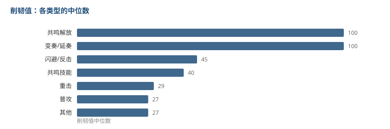

# 削韧值是怎么分层的

前两篇看了无敌帧和协奏能量。这篇看削韧值：一个动作能削掉对方多少韧性。

5425 个动作里有 3311 个带这个字段，中位数 30，最高 405。

## 按动作类型排一下，层级很清楚

| 类型 | 条数 | 中位数 | 最高 |
|---|---|---|---|
| 共鸣解放 | 152 | 100 | 405 |
| 变奏 / 延奏 | 12 | 100 | 200 |
| 闪避 / 反击 | 49 | 45 | 150 |
| 共鸣技能 | 787 | 40 | 400 |
| 重击 | 411 | 28.8 | 280 |
| 普攻 | 1535 | 26.7 | 384 |

**大招的中位数是普攻的 3.7 倍。**

有意思的是重击和普攻几乎一样（28.8 对 26.7）。重击打得慢、倍率高，但削韧没有相应提高。也就是说重击在「伤害」这一维是有优势的，在「破韧」这一维基本等于普攻。

## 取值几乎都是整数档

| 值 | 条数 |
|---|---|
| 100 | 107 |
| 30 | 92 |
| 50 | 85 |
| 40 | 83 |
| 5 | 66 |
| 10 | 60 |
| 15 | 60 |
| 200 | 56 |
| 60 | 53 |
| 20 | 53 |
| 80 | 50 |
| 400 | 43 |

除了一部分 26.7、28.8 这种除不尽的数（大概是单段值乘段数算出来的），其余全是 5 的倍数。

**这说明削韧是按档位手配的，不是一个连续公式生成的。**

## 400 像是一个天花板

最高值是 405（大招-一日唱），但 400 出现了 43 次，大量不同角色的大招最后都落在 400。

也就是说大招的破韧能力基本被统一到了同一个量级，角色之间在这里几乎没有差异。

差异化在下面几档：技能是 40，反击是 45，普攻是 26.7。

## 我的理解

削韧不像伤害那样，需要每个角色单独调。它更像**节奏控制器**：

- 大招给 400 这种统一量，是为了保证「每个角色都有一次稳定破韧的机会」
- 普攻给 26.7，是要你打十几下才破一次
- 技能给 40，介于两者之间

如果每个角色的大招削韧都不一样，破韧节奏就会变成「谁的大招强谁破得快」，配队会很快收敛到少数几个角色。统一成 400 之后，破韧的差异就转移到技能和普攻的密度上了。

这是把**乘区之间的差异挪到了频率上**，而不是挪到单次数值上。和伤害那边「给不同角色不同的稀有乘区」是相反的思路。

## 局限

- 我只看了削韧值这一列，没有算「每秒削韧」。因为时长字段有大量异常值（上一篇提过），算出来不可信。
- 类型是我按动作名字里的关键词归的类（普攻/重击/E/大招/变奏/闪避），不是表里原有的字段。名字不规范的动作会有误判，归到「其他」的 363 条里可能有错放的。
- 表里有两个哨兵值（10000 及以上），代表「削满」之类的特殊含义，我已经排除在统计外。

到此拆了三列：无敌帧、协奏回收、削韧值。表里还有动作结束帧、判定范围、时间膨胀没动。
