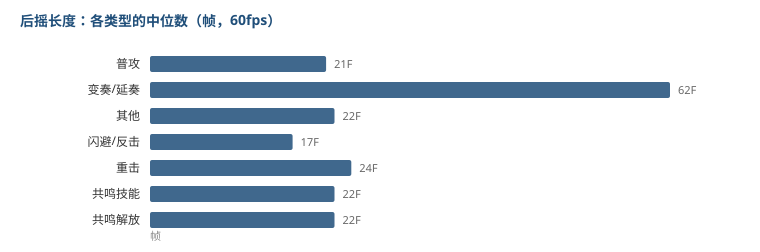

# 后摇其实是个常数

这篇看动作时长。

表里有三个时间字段：发生帧（判定从哪一帧开始）、持续帧（判定持续多久）、动作结束帧（动画到哪一帧结束）。

三者齐全的动作只有 1593 个。剩下的大部分缺结束帧，应该是那些靠触发器衔接、没有明确收尾的动作。样本不算大，但够看出结构。

## 完整动作多长

中位数 **70 帧，1.17 秒**。

## 但后摇几乎不随类型变

后摇我按 `结束帧 − 发生帧 − 持续帧` 算，也就是「打完了但还不能动」的那一段。

| 类型 | 样本 | 动作长度 | 后摇 | 后摇占比 |
|---|---|---|---|---|
| 普攻 | 44 | 40F | 21F | 57.1% |
| 变奏/延奏 | 15 | 180F | 62F | 36.7% |
| 闪避/反击 | 91 | 50F | 17F | 35.0% |
| 重击 | 179 | 69F | 24F | 34.6% |
| 共鸣技能 | 324 | 78F | 22F | 31.0% |
| 共鸣解放 | 88 | 211F | 22F | 16.8% |

**看「后摇」那一列：21、17、24、22、22。**

除了变奏/延奏，其余都在 17～24 帧之间，也就是 0.28～0.40 秒。

而「动作长度」那一列是 40 到 211 帧，差 5 倍。

**后摇是常数，动作长度才是变量。**

## 所以后摇占比是被动作长度带跑的

大招的后摇占比只有 16.8%，不是因为它收招快（它也是 22 帧），是因为它本身有 211 帧长。

普攻占比 57%，也不是因为它收招慢（21 帧），是因为整套只有 40 帧，一半时间都在等它结束。

**「这个角色手感笨重」这件事，在数据上不是后摇长，是动作长。**

## 一个例外：变奏 / 延奏

这一类的后摇是 62 帧，明显高出一截，是其他类型的三倍。

这类动作本来就是换人衔接的过场，长一点可以理解。不过样本只有 15 条，代表性有限。

## 顺带：顿帧

命中时的停顿，中位数 **3 帧**（0.05 秒），最大 56 帧。

3 帧不到一眨眼，玩家其实感知不到「停了一下」，但打击感很大一部分就来自这个。这属于调参数调出来的东西，不是算出来的。

## 局限

- 只有 1593 个动作三个时间字段齐全。普攻只有 44 条样本，变奏/延奏只有 15 条，这两行的中位数不太稳。
- 后摇的算法是我自己定的（结束帧减发生帧减持续帧）。多段攻击的实际结构比这个复杂，这样算出来的值偏粗。
- 类型还是按名字关键词归的，会误判。表里 852 条落到「其他」，它们的中位数占了总中位数的一大半，说明这批数据我没能吃透。

前四篇一共拆了四列：无敌帧、协奏回收、削韧值、动作时长。表里还剩判定范围、时间膨胀、韧性恢复没动。
