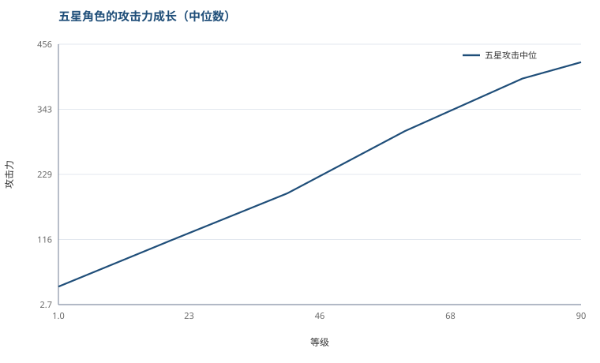

# 所有角色的成长曲线是同一条

上一篇拆敌人，这篇拆角色面板。

60 个角色的数据里，判断每个角色从 1 级到 90 级攻击力涨了多少倍。

结果是：**全部 12.50 倍。**

五星 49 个，四星 11 个，没有例外，连小数位都一样。

这不太可能是巧合，说明成长曲线是全局统一的一份。

## 突破节点的倍率也是常数

角色每 10 级左右要突破一次。突破那次攻击力会跳一截。

我把六个突破节点前后两级拿来比，看 60 个角色是不是同一套倍率：

| 节点 | 倍率 | 实际增幅 | 样本 |
|---|---|---|---|
| Lv19 → 20 | 1.3315 | +33.15% | 60/60 一致 |
| Lv39 → 40 | 1.1685 | +16.85% | 60/60 一致 |
| Lv49 → 50 | 1.1275 | +12.75% | 60/60 一致 |
| Lv59 → 60 | 1.1025 | +10.25% | 60/60 一致 |
| Lv69 → 70 | 1.06 | +6.00% | 60/60 一致 |
| Lv79 → 80 | 1.0528 | +5.28% | 60/60 一致 |

**每个节点，60 个角色的数值一模一样。**

而且能看到明显的衰减：第一次突破给 +33%，最后一次只给 +5.3%。

## 12.5 倍是这么组成的

六个突破乘起来：

```
1.3315 × 1.1685 × 1.1275 × 1.1025 × 1.06 × 1.0528 ≈ 2.16
```

所以 1→90 的 12.5 倍里，**突破贡献 2.16 倍，逐级成长贡献 5.79 倍**（12.5 ÷ 2.16）。

也就是说角色变强的主要部分仍然是「升级」，但突破那几次的跳变很陡 —— 第一次突破就给了全程 2.16 倍里的 1.33 倍。

这解释了为什么 20 级突破前后的手感差异那么明显。



## 那角色之间差在哪

既然曲线一样，差异就只在起点上。

| 稀有度 | 人数 | Lv90 攻击中位 |
|---|---|---|
| 五星 | 49 | 425.0 |
| 四星 | 11 | 262.5 |

四星是五星的 61.8%。

五星的攻击成长曲线大致是：

| 等级 | 中位攻击 |
|---|---|
| Lv1 | 34.0 |
| Lv20 | 113.9 |
| Lv40 | 196.7 |
| Lv60 | 305.0 |
| Lv80 | 396.3 |
| Lv90 | 425.0 |

## 我的理解

这套设计的核心是：**成长曲线只做一份，角色差异用起点和稀有度系数控制。**

好处很直接 —— 做平衡的时候只需要盯住 Lv1 那个值。定了起点，90 级是多少自动就定了，不用逐个角色调曲线。

如果每个角色一条独立曲线，那 60 个角色就是 60 条要单独验证的曲线，版本一更新就是灾难。

代价是角色在同等级下的相对强度被锁死了：一个五星角色在 90 级永远是另一个五星的固定倍数，除非靠技能倍率和乘区去拉差异。

这也和前面拆出来的东西对上了 —— 武器靠副属性换乘区、削韧靠频率拉差异、伤害靠稀有乘区区分角色。**能拉开差距的地方都在别处，面板本身是标准化的。**

## 局限

- 我只算了攻击，生命和防御没算。它们大概率是同一套倍率，但我没验证。
- 稀有度用的是数据里的 `rank` 字段，我按分布（49 五星、11 四星）认为它对应游戏内星级，没有逐个核对。
- 我筛掉了一部分 1 级或 90 级数据缺失的条目，60 个是筛完剩的。原始下载的 64 个角色里有几个文件没下全，补上之后结论应该不变，但样本会多一点。

到这儿拆了七类：无敌帧、协奏、削韧、后摇、武器、敌人、角色面板。
