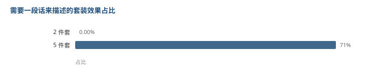

# 声骸套装：2 件套填属性，5 件套定玩法

37 套声骸里，有 31 套能同时拿到 2 件套和 5 件套的效果描述。

把 31 套的效果按「描述长度」和「加成类型」排一下，结构非常清楚。

## 2 件套：一句话说完

| 类型 | 套数 |
|---|---|
| 伤害加成 | 21 |
| 充能 | 4 |
| 治疗 | 3 |
| 攻击 | 2 |
| 生命 | 1 |

**31 条里，没有一条描述超过 40 个字。**

基本都是这种格式：「冷凝伤害提升 10%」。一行说完，没有条件、没有持续时间、没有触发。

## 5 件套：一半以上要写一段话

| 类型 | 套数 |
|---|---|
| 伤害加成 | 25 |
| 攻击 | 5 |
| 机制/其他 | 1 |

同样是 31 条，**有 22 条描述超过 40 个字**。

随便挑几条看：

> **雪落无声之愿**：角色为敌人添加【霜渐效应】时，冷凝伤害提升{0}，持续{1}秒。自身获得【落雪】效果……

> **羽落空尘之歌**：角色为敌人添加【虚湮效应】时，获得【玄翎之羽】：自身暴击提升{0}，重击伤害加成提升{1}，持续{2}秒……

> **茜染怀想之花**：为队伍中角色提供治疗时，队伍中角色攻击提升{0}，持续{1}秒，同名效果之间不可叠加……

全都是「**当 XX 发生时，获得 YY，持续 ZZ 秒**」的结构。

## 两类效果的分工

**2 件套是静态的。**它只做一件事：往某个属性上加一个固定数值。你装上它就生效，不需要操作，也不需要队友。

**5 件套是条件触发的。**它必须挂在某个事件上：给敌人挂上特定效应、施放延奏技能、进行治疗。

而且注意那些触发条件 ——「霜渐效应」「虚湮效应」「聚爆效应」「电磁效应」，全是元素反应。

这意味着 **5 件套实际上在给角色划流派**。你带哪套 5 件套，等于宣告你要打哪种元素反应，配队和输出手法都得跟着变。

## 我的理解

这个分工很像很多游戏里的「主属性 vs 套装特效」，但这里切得更干净：

- 2 件套负责**补短板**。面板上缺伤害就补伤害，缺充能就补充能，是纯数值工具。
- 5 件套负责**定身份**。它不是加数值，是加规则。

为什么这么切？因为如果 2 件套也带条件，那配装就有了两个复杂度的来源：既要凑条件，又要凑件数。现在只让 5 件套带条件，玩家做决策的时候只在一个维度上纠结。

而且 2 件套能拼两套（2+2），5 件套只能穿一套全的。**2 件套做成通用数值，才能支持 2+2 这种组合；如果 2 件套也带条件，2+2 就变成了条件叠加，很容易出 bug 或者超模。**

## 局限

- 37 套里只有 31 套同时有 2/5 件描述，剩下 6 套我没有细看，可能是单件套或者数据结构不同。
- 分类是按中文描述里的关键词硬匹配的。像「共鸣效率」我归到充能，但有些描述可能同时提了两种加成，我只取了第一个命中的。
- 我只看了中文文本和参数个数，没有算「这套比那套强多少」——那需要把每套的触发覆盖率也算进去，那是另一个量级的工作。

到这儿拆了八类。声骸这一块还剩主词条和副词条的数值分布没动，但那个数据在这个文件里没有，得另找。
