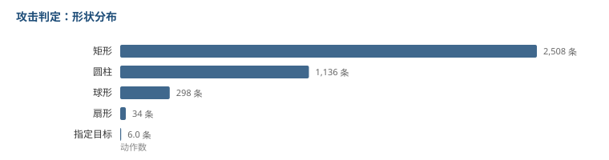

# 六成攻击是盒子

表里有一列叫「判定范围」，写的是每一次攻击挂什么形状、多大。

3982 条记录，去重后有 1016 种不同写法，说明这不是填着玩的字段。

## 形状分布

| 形状 | 条数 | 占比 |
|---|---|---|
| 矩形 | 2508 | 63.0% |
| 圆柱 | 1136 | 28.5% |
| 球形 | 298 | 7.5% |
| 扇形 | 34 | 0.9% |
| 指定目标 | 6 | 0.2% |

**六成以上是矩形。**

矩形写起来是 `矩形(长,宽,高)`。近战挥一刀，判定就是身前一块盒子，这样能贴合挥击的轨迹，也能解释为什么「贴着怪打」和「离一步打」命中数不一样。

圆柱是 `圆柱(半径, 0, 高度)`，中间那个维度恒为 0 —— 它是二维的圆，向上拉出一个高度。适合「以角色为圆心的范围」，比如一圈 AOE。

球形用得少，7.5%。



## 按动作类型看，有一类反过来了

| 类型 | 条数 | 主要形状 |
|---|---|---|
| 闪避/反击 | 124 | 矩形 110（88.7%） |
| 重击 | 466 | 矩形 316（67.8%） |
| 共鸣技能 | 904 | 矩形 501（55.4%） |
| 共鸣解放 | 196 | 矩形 85，圆柱 78 |
| 变奏/延奏 | 66 | **圆柱 36，矩形 26** |

除了变奏/延奏，其他全是矩形占多数。

**变奏和延奏是唯一圆柱多于矩形的一类。**

这合理：换人进来的那一下，本质是「在角色位置放一个范围效果」，而不是「挥一刀」。所以它天然是圆心的，不是盒子的。

闪避反击 88.7% 是矩形，也合理 —— 那是贴脸近身的一下。

## 尺寸

| 形状 | 主维度中位 | 范围 |
|---|---|---|
| 矩形长度 | 240 | 5 ～ 4000 |
| 圆柱半径 | 600 | ～ 5000 |

矩形长度中位 240，最短 5。5 的那批大概是「紧贴身体」的判定，比如身上挂的特效。

圆柱半径中位 600，比矩形的长度大不少 —— 圆是往四周铺开的，盒子只往一个方向伸。

## 有意思的地方：判定最大的不是攻击

我按体积排了前八名，结果全是同一个值：

```
球形(5000,0,0)
```

出现在这些动作上：

| 动作 |
|---|
| 被动1-雪绣1层 |
| 被动1-雪绣3层 |
| C6被动1-雪锈2层 |
| 千面魅影-转化标记 |
| 千面魅影-刷新印记 |
| 审判之雷-判断 |
| 音律独奏 |
| 大招-音律独奏 |

一半是「被动」「标记」「判断」这类东西，不是打人的动作。

**半径 5000 基本等于全场。** 这些动作用这么大的判定，不是因为它们范围大，是因为**它们压根不关心距离** —— 施加一个 buff、刷新一个印记，本来就不该受距离限制。

所以看这一列的时候，判定范围大不等于这个攻击强。要先分清它是「打人」还是「挂状态」。

## 局限

- 体积是我自己算的近似值，球形的公式用的是半径的三次方，但字段里 `球形(5000,0,0)` 后面两个 0 说明它的参数格式和矩形不同，我不能确定第一个数是半径还是直径。
- 「其他」这个类别有 2167 条，占了一半多，说明我的关键词归类对动作名的覆盖率不够。真实类型分布可能和我列的不完全一样。
- 我只看了形状和尺寸，没看位置偏移（基准偏移、中心位置偏移），那两个字段决定了盒子从身体的哪个点长出去，对实际命中影响也很大。

到这儿拆了九类。
