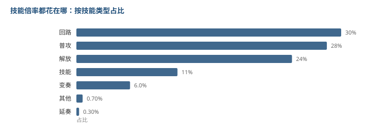

# 共鸣技能只占 11%

60 个角色的技能表里，每个技能都有 10 级的倍率。把它们加起来，看看倍率都花在哪。

## 先看总量

| | 值 |
|---|---|
| 中位 | 44.94 |
| 最低 | 7.32 |
| 最高 | 118.63 |

跨度 16 倍。但这个数不能直接当强度排名看，原因我在最后说。

## 倍率花在哪：三大块占八成

| 技能类型 | 占比 |
|---|---|
| 共鸣回路 | 29.6% |
| 常态攻击（普攻） | 28.0% |
| 共鸣解放（大招） | 24.1% |
| 共鸣技能（E） | 11.3% |
| 变奏技能 | 6.0% |
| 延奏技能 | 0.3% |

回路、普攻、解放三块加起来 **81.7%**。

## 最反直觉的一条：E 的倍率最低

共鸣技能（E）通常是一个角色最有存在感的技能之一，冷却短、要主动按、还有各种形态。

但它在总倍率里只占 **11.3%**，比普攻还低一半多。

我的理解是：**E 的定位不在伤害上，在功能上。**

它负责挂元素效应、位移、充能、切形态。这些事在倍率表上看不出来，因为它们的价值体现在别的地方——比如上一篇拆的削韧值，E 的中位是 40，是全类型里第二高的。

所以 E 是「低倍率、高功能」的技能。用总倍率去衡量它，会低估它。

## 变奏只有 6%

换人那一下倍率很低，这也合理：它是衔接动作，不是输出动作。

但它有个别的价值 —— 上一篇拆判定范围时发现，变奏/延奏是唯一圆形判定占多数的类型，说明它的作用是「在位置放一个效果」，不是「打一下」。

## 为什么总量排名不能直接用

总和最高的几个：

| 角色 | 总和 |
|---|---|
| 心 | 118.63 |
| 琳奈 | 106.26 |
| 露西 | 83.56 |
| 尤诺 | 78.61 |
| 锁暝 | 74.30 |

心排第一，但她是双形态角色（应世相 / 照世相），技能表里两套形态各有一份倍率。

**多形态角色的总和天然更高，因为表里的条目多了一倍。**

所以这个排名更接近「这个角色的技能表有多满」，而不是「这个角色有多强」。要真比强度，得先给每个角色定一套实际会打的循环，只取循环里用到的那些动作。

那需要逐角色配轴，是另一个量级的工作，我没做。

## 局限

- 总量受「形态数量」影响，跨角色不可直接比。这条我特意写在正文里，因为它是最容易误读的地方。
- 我只取了第 10 级，没考虑 1 到 10 级的成长曲线，也没考虑技能等级是否都能升满。
- 冷却时间、能量消耗这些非百分比条目被自动排除了（我的解析器只认带 `%` 的），所以「倍率/冷却」这种效率指标没做。
- 数据里 64 个角色文件，有 4 个没下全，实际参与统计的是 60 个。

到这儿拆了十类。
