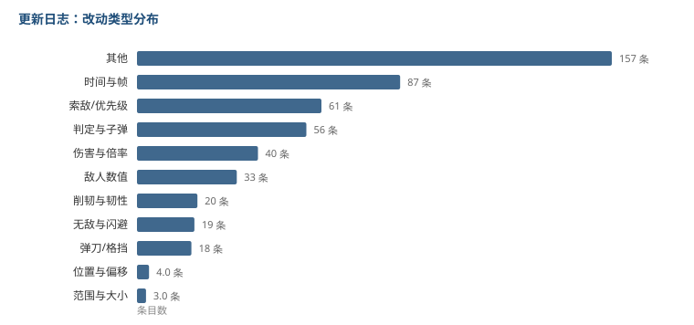

# 更新日志里，纯数值改动只占 8%

表里有一页叫「更新变动」，记的是每次更新改了什么。

498 条，覆盖 91 次更新，时间从 2024 年 6 月到 2026 年 10 月，两年多。

这份日志比前面拆的任何一列都更接近数值策划的日常——它记的就是「你每天在改什么」。

## 节奏

| | |
|---|---|
| 更新次数 | 91 次 |
| 改动条目 | 498 条 |
| 单次中位 | 3 条 |
| 单次最多 | 47 条 |

**大部分更新只动两三条。** 动几十条的那种大改，两年里只有几次。

按年份：2024 年 93 条，2025 年 225 条，2026 年 180 条。第二年明显更密集，之后稳定在一个量级。

## 改的是什么

| 类型 | 条数 | 占比 |
|---|---|---|
| 其他 | 157 | 31.5% |
| 时间与帧 | 87 | 17.5% |
| 索敌 / 优先级 | 61 | 12.2% |
| 判定与子弹 | 56 | 11.2% |
| **伤害与倍率** | **40** | **8.0%** |
| 敌人数值 | 33 | 6.6% |
| 削韧与韧性 | 20 | 4.0% |
| 无敌与闪避 | 19 | 3.8% |
| 弹刀 / 格挡 | 18 | 3.6% |

把「时间与帧、索敌、判定与子弹、无敌、弹刀、削韧」这六类加起来，是 **52.3%**。

**一半以上的改动是在动动作和判定，纯伤害数值只占 8%。**

这和我原本的想象完全相反。我以为运营一款战斗游戏，主要工作就是调伤害——事实上伤害是最少动的一块。



## 一个把两篇文章连起来的细节

「其他」里有一条：

```
闪避无敌 0.3s → 0.35s
极限闪避判断 0.3s → 0.35s
```

0.35 秒，正好是 21 帧。

第 01 篇拆无敌帧的时候，我发现普通闪避的档位就是 **21 帧**，而且有 53 条动作共用这一个值。

现在知道那个 21 不是设计出来就定死的，是某一次更新从 18 帧（0.3 秒）调上来的。

**一个看起来像「规格」的数字，其实是某次调整的产物。** 这类痕迹只有把更新日志和当前数据对上才看得见。

## 被改最多的角色

| 角色 | 次数 |
|---|---|
| 千咲 | 42 |
| 赞妮 | 23 |
| 西格莉卡 | 18 |
| 莫宁 | 15 |
| 琳奈 | 13 |

千咲一个人占了 42 条，接近总量的十分之一。

这个分布很不均匀。可能的原因有两个：要么这个角色的机制特别复杂，改一处牵动很多处；要么上线时状态不好，接连修了几次。

光看日志分不出来，得把每次改动的内容拉出来对比才知道。这个我没做。

## 我的理解

52% 的改动在动作和判定上，这件事对想做数值的人有直接含义：

**在动作游戏里，「数值」不只是伤害公式。** 判定框多大、索敌优先谁、无敌给几帧、能不能弹刀，这些参数同样决定一个角色强不强，而且改动频率比伤害高一个数量级。

会算伤害只是入门，能判断「这个角色的手感问题应该改判定还是改帧数」才是这行的日常。

## 局限

- 「其他」还有 31.5%，我的关键词分类没覆盖全。抽样看过，里面混着敌人生命值、弹刀属性、无敌时长这些，我已经补了几类，但仍有遗漏。
- 分类是按关键词硬匹配的，同一条改动如果同时涉及帧数和判定，只会归到先命中的那一类。
- 「被改最多的角色」是靠角色名匹配出来的，如果日志里用的是简称或者代号，会漏。
- 这是玩家整理的表，不一定收录了全部改动。真实总量可能更大，但比例应该差不多。

到这儿拆了十一类。这一篇的数据源（更新日志）和前面十篇都不一样，是唯一带时间维度的一份。
