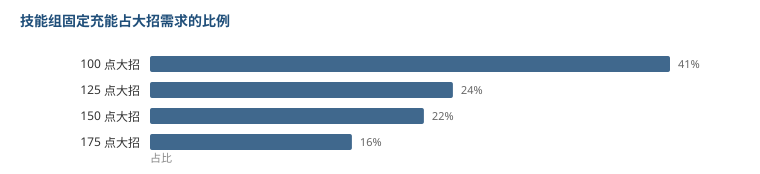

# 大招越贵，充得越慢——而且没有补贴

上一篇推出「大招能量 = 协奏能量 × 0.5」。既然比值固定，那大招要多少能量，就直接决定了循环有多长。

那就该问一句：**消耗高的角色，是不是给了更多的充能手段来补偿？**

答案是：没有。

## 数据

从官方数据里抽每个角色技能组里的「回复协奏能量」，加总，再乘 0.5 折成大招能量。

| 单次大招消耗 | 角色数 | 技能组固定回复（协奏） | 折成大招能量 | 占需求比 |
|---|---|---|---|---|
| 100 | 4 | 90.0 | 45.0 | **45.0%** |
| 125 | 41 | 60.0 | 30.0 | 24.0% |
| 150 | 7 | 65.0 | 32.5 | 21.7% |
| 175 | 6 | 60.0 | 30.0 | **17.1%** |

看第二列和第三列：消耗从 125 涨到 175，固定回复量几乎没动（60 → 60）。

所以占需求的比例一路从 45% 掉到 17%。

**要 175 点大招的角色，技能全放一遍只充了 17%。要 100 点的角色，同样一遍充了 45%。**

## 这意味着什么

技能组提供的充能是**绝对量**，不是按需求比例给的。

一个角色如果大招贵，他并不能靠多放几个技能把差额补回来——技能就那么几个，回复量也还是那么多。差额只能靠普攻逐击慢慢磨。

结果就是：**高消耗角色的大招循环天生更长，这是设计选择，不是疏忽。**

为什么这么设计？因为消耗高低大概率是用来平衡大招强度的。效果更强的大招给更高的门槛，循环变长就是代价。如果还按比例补贴充能，那这个门槛就形同虚设了。

## 两种充能的性质

把数据分成两半看，会更清楚这游戏的能量是怎么来的：

| 来源 | 性质 | 特点 |
|---|---|---|
| 技能固定回复 | 绝对量，一次性 | 每个角色一套固定的数，不随需求变 |
| 普攻逐击回复 | 按次数累积 | 每个动作零点几到十几点，靠频率堆 |

技能给的那部分，占需求的 17%~45%。**剩下的 55%~83% 全靠普攻打出来。**

这解释了为什么「输出循环的密度」这么重要——你打得越快，大招越快，不是因为你伤害高，是因为你打的次数多。

也解释了为什么有些角色看起来倍率不高但实战很强：他的普攻帧数短，同样 25 秒里能多打几十下，大招转得更快。

## 局限

- 我只统计了技能组里明确写了「回复协奏能量」的条目，没算普攻的逐击回复。所以这里的数字是「固定部分」，不是总充能。
- 消耗 100 的角色只有 4 个，样本太小，那一行 45% 的数字不太稳。
- 协奏上限 100 是沿用的常见值，官方数据里没直接给。
- 「技能全放一遍」不是真实循环。真实循环里技能有冷却，不可能同时全放。这个数字只是上限。
- 数据里有 60 个角色有完整信息，另外几个文件没下全。

前一篇看的是两条能量线的换算关系，这篇看的是不同角色之间充能预算的差异。下一篇可以试着把这两个合起来——给定一个角色的技能组，估他大招的实际循环秒数。但那需要每个角色的输出轴，我手上没有。
