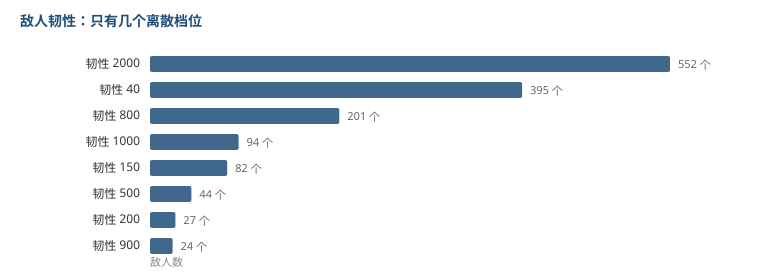

# 破一个韧性条要几下

第 03 篇拆的是角色能削多少韧性，这篇拆对面有多少。

两侧对上，才能算出「破韧要几下」。

## 敌人韧性只有几个档位

1533 条敌人记录里，「韧性」这个字段的取值分布是这样：

| 韧性 | 敌人数 |
|---|---|
| 2000 | 552 |
| 40 | 395 |
| 800 | 201 |
| 1000 | 94 |
| 9999 | 90 |
| 150 | 82 |
| 500 | 44 |
| 200 | 27 |
| 900 | 24 |
| 400 | 10 |

**只有十个左右不同的值，全是整数档位。**

和敌人血量一样，这是查表配出来的，不是逐怪调的。

（9999 那 90 个应该是「破不了」的哨兵值，比如某些机制怪或者建筑。）

## 而且不随等级变

| 等级 | 样本 | 韧性中位 |
|---|---|---|
| 40 | 30 | 2000 |
| 60 | 32 | 2000 |
| 80 | 68 | 1000 |
| 90 | 217 | 1000 |
| 100 | 812 | 800 |
| 110 | 34 | 2000 |
| 120 | 34 | 2000 |

**同一只怪从 40 级到 120 级，韧性不变。**

这和血量完全相反——血量从 3 万涨到 1380 万，涨了 400 多倍，而韧性一动没动。

所以韧性是怪物的**固有属性**，等级只放大血量和伤害。

## 那要几下才能破

拿第 03 篇的削韧数据来对：

| 类型 | 削韧中位 |
|---|---|
| 共鸣解放 | 100（上限 400） |
| 共鸣技能 | 40 |
| 闪避/反击 | 45 |
| 重击 | 28.8 |
| 普遍 | 26.7 |

算一下不同韧性档要打多少次：

| 目标韧性 | 大招(400) | 技能(40) | 普攻(26.7) |
|---|---|---|---|
| 200 | 1 次 | 5 次 | 8 次 |
| 500 | 2 次 | 13 次 | 19 次 |
| 800 | 2 次 | 20 次 | 30 次 |
| 1000 | 3 次 | 25 次 | 38 次 |
| 2000 | 5 次 | 50 次 | 75 次 |

**800 韧性的怪，两个大招就破。**

这也解释了第 03 篇那个发现：为什么大招的削韧值被统一到 400。因为 400 正好是「两次破开主流韧性档（800）」的量。

如果每个角色的大招削韧不一样，破韧节奏就会变成「谁大招强谁破得快」，配队会收敛。统一成 400 之后，破韧速度只取决于你放几个大招。

## 恢复也是个变量

敌人「韧性恢复」的取值：

| 恢复值 | 敌人数 |
|---|---|
| 1 | 387 |
| 100 | 311 |
| 20 | 248 |
| 50 | 205 |
| 500 | 45 |

有 311 个敌人的恢复值是 100，45 个是 500。

如果你的削韧速度跟不上恢复速度，那就永远破不了。比如一个恢复 500 的敌人，你靠普攻（26.7/次）打，得在它回满之前打出 19 次——按攻击频率算，这基本做不到。

**所以「能不能破韧」不是看你削韧总量，是看你的削韧速率和对方的恢复速率谁更快。**

## 我的理解

把两侧数据合起来看，破韧这个系统是这样分工的：

- **韧性档位**（敌人侧）：决定这个目标值不值得破。2000 的怪要 5 个大招，性价比低。
- **恢复速率**（敌人侧）：决定你必须持续压制，不能打打停停。
- **削韧值**（角色侧）：大招统一 400 保证基础能力，技能和普攻的密度决定上限。

这三件事分开配，好处是调整互不干扰：想让某个怪更难破，调它的韧性档；想让某类怪必须速攻，调恢复；想加强某个角色，调他技能的削韧。

如果全揉成一个数，就没有这个自由度了。

## 局限

- 韧性表里没有单位（是「点」还是「条」），我按点数处理。
- 韧性恢复的数量单位我没确认，可能是每秒也可能是每帧，所以「恢复速度能不能跟上」这句只能定性说，不敢给数。
- 9999 那 90 个我判断是哨兵值，但没有逐个核对。
- 削韧那一侧用的是各类型的中位数，实际每个技能不一样，套到具体敌人身上会有偏差。

前面第 03 篇拆角色侧，这篇拆敌人侧，合起来才算把破韧这个系统说完整。
